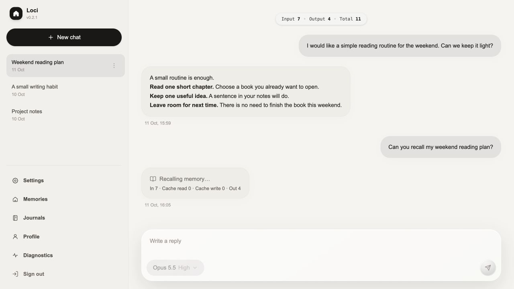
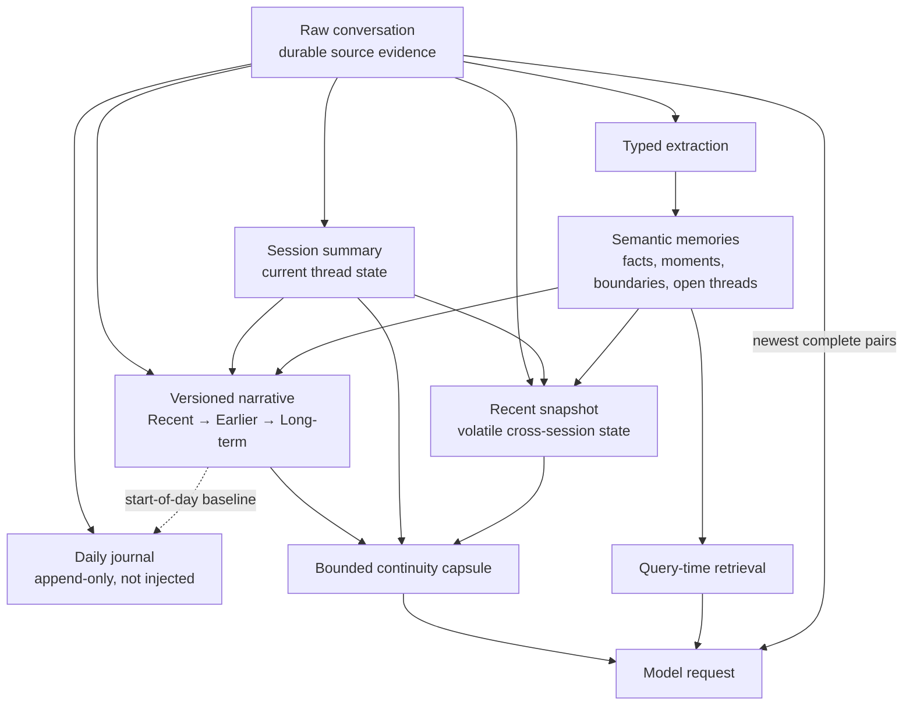
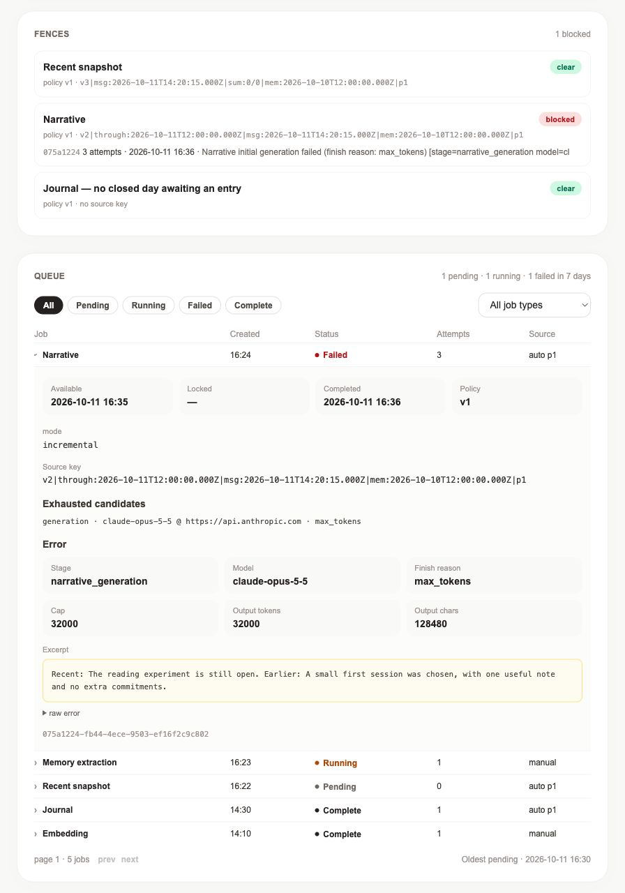
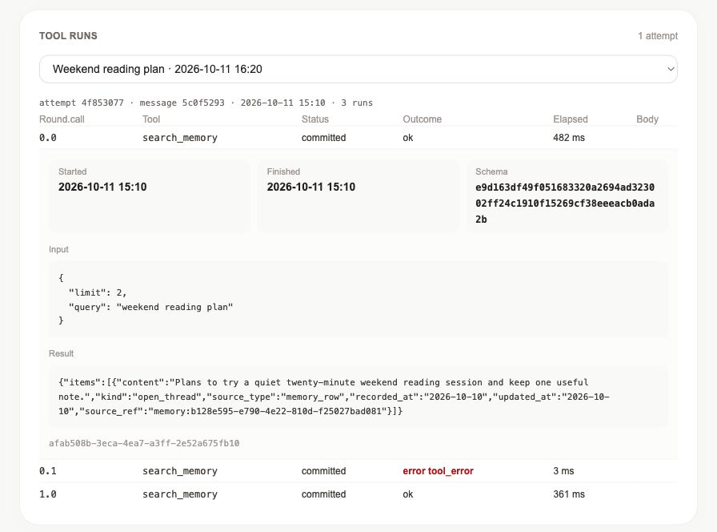
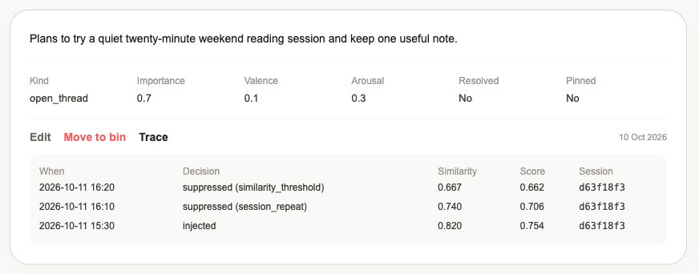

# loci

Personal AI infrastructure: a self-hosted assistant with layered long-term
memory.

loci keeps the raw conversation as evidence while maintaining several memory
timescales for continuity across sessions. It constructs every model request
under explicit context budgets, and it runs tools and background writers under
bounded attempts with durable provenance. PostgreSQL and pgvector hold the
conversation, memory, queue, and diagnostic traces in one inspectable system.




All previews use synthetic data in disposable databases. The chat preview uses
a local mock provider; diagnostic previews use seeded example records.

## Memory architecture

The system separates source evidence from generated projections. Each layer
has a different lifetime and a different reason to exist.



Raw messages are not deleted when a summary advances. Semantic memories keep
source ids, salience, lifecycle state, and embeddings. The narrative is a
bounded re-telling with three age horizons; the recent snapshot carries
short-lived cross-session state; the daily journal is append-only evidence and
does not consume per-turn context.

The longer design rationale is in
[`docs/design-records/narrative-layer-lifecycle.md`](docs/design-records/narrative-layer-lifecycle.md).
The proposed next memory model—source evidence, episodes, versioned claims,
and threads—is in
[`docs/memory-claim-layer-design.md`](docs/memory-claim-layer-design.md).

## Context construction and token budgets

Each request is assembled in a stable-prefix / volatile-tail order:

```text
cached prefix
  system prompt
  continuity capsule: narrative + current-thread summary + recent snapshot
  newest whole conversation pairs that fit
uncached tail
  local time + retrieved memory anchors + current user message
```

The input allowance reserves output tokens first. Tool-capable attempts reserve
additional space for bounded results and thinking. Every budget is counted in
one local unit: the three capsule writers — the long-horizon record, the
recent snapshot, and the thread summary — each state a target and are held to
a cap above it, and the capsule is a read limit the settings validate against
those caps, so a stored record renders in full instead of being trimmed on
every turn. The settings also refuse a context window too small to hold a
whole unsummarized history beside the capsule, so no turn leaves the request
before a summary covers it. The daily journal has no write cap and is never
machine-cut; only the shared output guard bounds it. Query-dependent anchors
ride in the uncached tail so a different retrieval result does not churn the
stable prompt prefix. The accounting rationale is in
[`docs/design-records/one-accounting-domain.md`](docs/design-records/one-accounting-domain.md).

Time is injected as context rather than used as a behavioral trigger. Stored
messages remain byte-stable; timestamps are added only while assembling the
model request.

## Reliability and failure handling

A periodic worker once rediscovered one poisoned source often enough to create
190 failed jobs and roughly two million billed tokens in two days, without a
new conversation. The fix was architectural: retry budget belongs to the
logical source transformation, not to a queue row that a tick can recreate.

Automatic continuity jobs now carry a readable source key made from their
input high-water marks and retry-policy version. A terminal failed row fences
that same work until new evidence, a policy change, or an explicit owner action
re-arms it. Provider candidates that terminate are recorded before fallback,
and model-output failures retain a bounded excerpt for diagnosis. The full
reasoning is in
[`docs/design-records/source-bound-retry-fences.md`](docs/design-records/source-bound-retry-fences.md).



The failed Narrative job fences the same source; the queue also shows memory
extraction and other background work.

Foreground generation has the same insistence on one outcome. A send creates
one server attempt; cancellation or failure retracts the unfinished pair, and
a retry replaces an old tail only when the replacement commits.
Request-terminal output never survives as a successful message.

## Tool loop

One visible reply may use several provider rounds, but they share one attempt
identity, deadline, cancellation signal, usage total, tool snapshot, and set of
budgets. Provisional prose before a tool call is buffered and replayed to the
provider; it never leaks into the visible answer or the conversation record.

Calls execute serially even if a provider returns several. The attempt allows
at most three tool rounds before finalization, six calls, 800 estimated tokens
per result, 2,000 across results, two recoverable failures, four hosted-tool
pauses, and five minutes wall-clock. Reaching a limit requests a final answer,
then uses one bounded hard-final round if necessary.

`tool_runs` stores staged, committed, retracted, and superseded calls outside
the message table. Bodies (input, result, preceding text) are purged lazily:
when a conversation next starts a reply, its runs older than seven days lose
them. A conversation that never starts another reply keeps its bodies.
Ordering, status, timing, outcome, and schema hash always remain. See
[`docs/design-records/tool-loop-attempt-semantics.md`](docs/design-records/tool-loop-attempt-semantics.md).

The first client tool is semantic memory search. Client tools are enabled by
default in this public snapshot, but the runtime exposes none unless all
`EMBEDDING_*` values are configured (including `EMBEDDING_DIMENSIONS=1536`). Provider-hosted web search has a separate
setting and capability check.



One attempt, two rounds: `0.0`, `0.1`, and `1.0` retain call order, including a
recoverable tool error. The expanded call exposes its query and result.

## Evaluating the memory pipeline

The deterministic suite replays frozen sources, labels, and candidate outputs:

```bash
npm run eval:content -- --ci
```

Cases name observable failures instead of collapsing quality into one score:
chronological day logs, center starvation, unpaid withholding, quiet-day
inflation, prompt-example anchoring, narrative section loss, labeled detail
loss, and extraction coverage. A known-bad candidate passes when it still
raises its pinned expected flags; a compliant reference should clear them.

The published fixtures are synthetic and use the same manifest contracts as
the private corpus. The default run is offline and deterministic; provider
generation and model judges are opt-in. The method and its limits are recorded
in
[`docs/design-records/content-discipline-evals.md`](docs/design-records/content-discipline-evals.md).

## Observability

`/diagnostics` is a read-only operator surface for:

- memory health, kinds, embedding gaps, and recent activity;
- per-memory injection and suppression traces;
- queue state, decoded failures, source fences, and exhausted candidates;
- tool calls ordered by attempt, round, and call.

The database also retains message usage, hosted-search provenance, continuity
source windows, narrative/journal carrier metadata, and request-size traces.
These records are designed to answer why a result appeared, why work stopped,
and which model path actually produced an artifact.



The same memory can be injected, suppressed as a recent repeat, or fall below
the similarity threshold; each recorded decision retains its score and session.

## Deployment

The reference deployment is one Docker host: Caddy publishes HTTPS, the
Next.js container serves the product and worker, a one-shot container runs the
migrations, and PostgreSQL 17 with pgvector keeps durable state.

Prerequisites are Docker Engine with Compose, a hostname whose DNS points to
the server, and inbound ports 80 and 443.

```bash
cp .env.example .env
chmod 600 .env
npm ci
```

Fill `DOMAIN`, `APP_ORIGIN`, the PostgreSQL password and matching
`DATABASE_URL`, `SESSION_SECRET` (at least 32 bytes), `OWNER_PASSWORD_HASH`,
and the required `CHAT_*` values. Generate the password hash without putting
the cleartext password in shell history:

```bash
read -s OWNER_PASSWORD
export OWNER_PASSWORD
npm run auth:hash-password
unset OWNER_PASSWORD
```

Paste the escaped Argon2id output into `.env` inside double quotes, keeping
every backslash: `OWNER_PASSWORD_HASH="<escaped output>"`. The quotes are
required for Compose to preserve the hash; this form also works with Next.js.
Then validate and start:

```bash
docker compose config --quiet
docker compose up --build -d
docker compose ps
curl --fail --silent --show-error "https://$DOMAIN/api/health"
```

Startup order is PostgreSQL health, migrations, application health, then
Caddy. Only Caddy publishes host ports. See
[`docs/deployment.md`](docs/deployment.md) for upgrades and security checks,
and [`docs/backup.md`](docs/backup.md) for dump and restore rehearsals.

For local development, publish PostgreSQL with the development override and
run the migrations yourself; nothing outside Compose runs them:

```bash
docker compose -f docker-compose.yml -f docker-compose.dev.yml up -d postgres
npm run db:migrate
npm run dev
```

Put the host-side connection string in `.env.local`, which Next.js and
`db:migrate` read and Compose does not, so the container URL in `.env` stays
as it is: `DATABASE_URL=postgresql://loci:<POSTGRES_PASSWORD>@127.0.0.1:5433/loci`.
Run `npm run db:migrate` again after pulling new migrations.

## Development verification

```bash
npm ci
npm run lint
npm run typecheck
npx vitest run tests/unit
npm run eval:content -- --ci
```

Database tests require an explicit disposable database; the suite runs the
full migration chain itself. With the development override up, create one
beside the development database and point the suite at it:

```bash
docker compose -f docker-compose.yml -f docker-compose.dev.yml exec postgres \
  createdb -U loci loci_test
TEST_DATABASE_URL='postgresql://loci:<POSTGRES_PASSWORD>@127.0.0.1:5433/loci_test' \
  npm run test:db
```

Browser tests also require a disposable `TEST_DATABASE_URL` and an isolated
test server. Never point either suite at a database whose data matters.

## More design context

- [`docs/architecture.md`](docs/architecture.md) — implemented boundaries and
  request flows
- [`docs/design-decisions.md`](docs/design-decisions.md) — decisions and
  reversals with their reasoning
- [`docs/design-records/`](docs/design-records/) — focused engineering records
- [`ROADMAP.md`](ROADMAP.md) — direction, not commitments

## License

[MIT](LICENSE)
