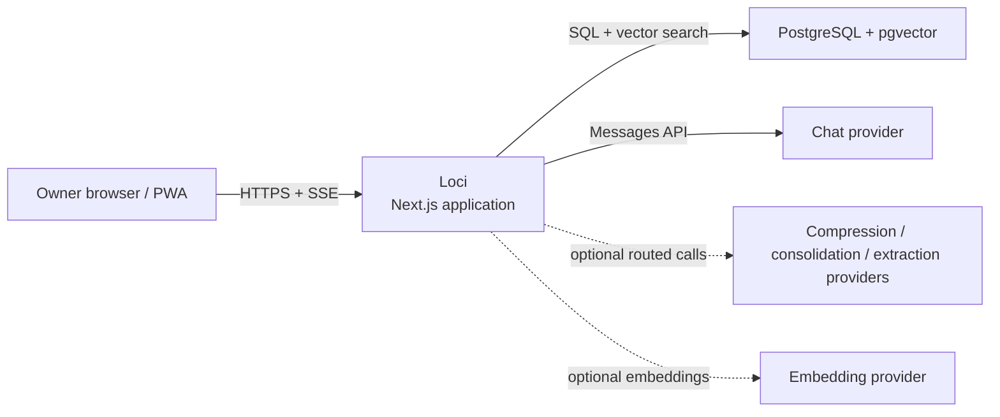
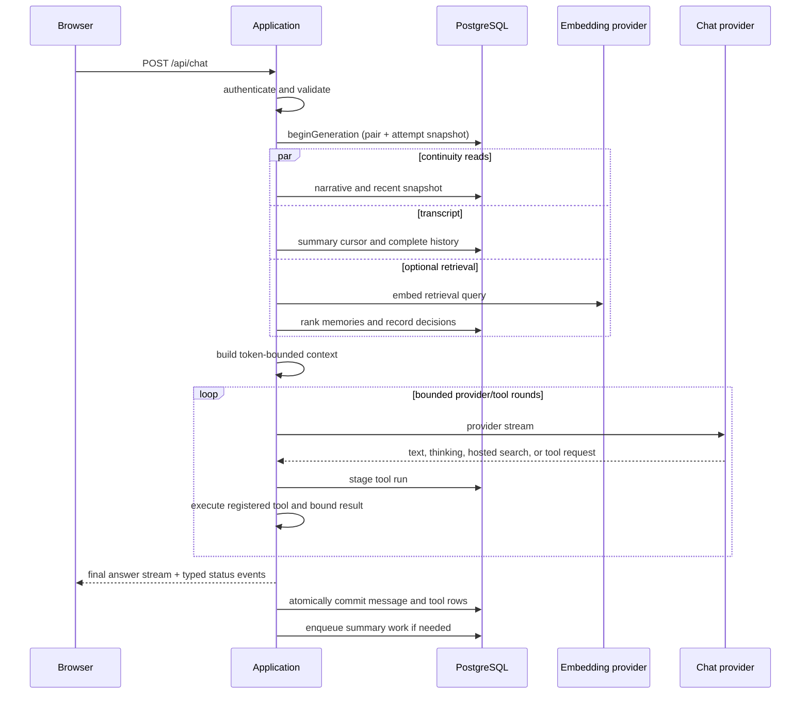

# Loci Architecture

| Field | Value |
| --- | --- |
| Version | 0.2.1 |
| Status | Implemented baseline |
| Created | 2026-06-14 |
| Last Updated | 2026-09-13 |
| Review Cycle | Update on architectural change |

## 1. Purpose

Loci is a private, single-user AI assistant with durable conversation
history and layered long-term memory. A Next.js modular monolith owns the UI,
HTTP API, chat orchestration, bounded tool loop, background memory writers,
and diagnostics. PostgreSQL with pgvector is the durable source of truth.

This document describes the implementation at v0.2.1. Design notes and the
decision ledger may describe later directions; they are not current behavior
unless this document and reproducible tests agree.

## 2. Architecture Principles

1. **Single-user first.** The system is designed for one owner and does not
   carry multi-tenant complexity.
2. **Modular monolith.** UI, API, orchestration, and background work live in
   one Next.js application, with clear internal module boundaries.
3. **PostgreSQL is the source of truth.** Messages, memory layers, settings,
   job state, and execution traces are stored in PostgreSQL.
4. **Preserve raw history.** Summarization and memory writing change model
   context, not the original chat record.
5. **Model providers are replaceable.** Workflows depend on local provider
   interfaces; endpoint and model selection stay at the provider boundary.
6. **Deterministic work belongs to code.** Context budgets, retrieval,
   persistence, retries, scheduling, and tool limits are enforced outside the
   model.
7. **Graceful degradation.** Chat remains usable when embeddings, retrieval,
   continuity reads, or background writers are unavailable.
8. **Operate the smallest useful system.** No service is added until it solves
   a measured reliability or scale problem.

## 3. Scope and Non-Goals

The implemented product includes password-protected access, multiple sessions,
streaming chat, retry and tail rewrite, configurable model routing, semantic
memory retrieval, a bounded client-tool loop, layered continuity writers,
memory and profile management, diagnostics, Docker deployment, and
deterministic content-discipline evals.

Deliberate non-goals:

- Multi-user registration, organizations, roles, billing, or conversation
  sharing
- Distributed application services, horizontal scaling, Redis, Kafka, or an
  external job queue
- An open-ended autonomous agent loop or unattended mutation tools
- A graph database or graph execution engine in the base architecture
- Native MCP integration, native mobile or desktop clients, and offline sends
- Automatic hard deletion or opaque forgetting of memory records

## 4. System Context and Deployment



API keys and database credentials never reach the browser. The reference
deployment is Docker Compose on one host:

```text
Internet → Caddy → Next.js application → PostgreSQL + pgvector
                         ├──────────────→ chat/model endpoints
                         └──────────────→ embedding endpoint (optional)
```

The application container also runs a small PostgreSQL-backed job worker. A
separate migration container completes before the application starts. Caddy
terminates TLS and waits for `/api/health`; PostgreSQL and Caddy state live in
named volumes.

## 5. Technology Baseline

| Area | Choice |
| --- | --- |
| Runtime | Node.js 22, TypeScript |
| Application | Next.js App Router, React, Tailwind CSS |
| Database | PostgreSQL 17, pgvector, Drizzle ORM / Kit |
| Validation | Zod |
| Streaming | Server-Sent Events over a streamed `fetch` response |
| Deployment | Docker Compose and Caddy |
| Verification | Vitest, Playwright, deterministic eval runner |

Exact dependency versions are pinned in `package-lock.json`.

## 6. Application Modules

```text
src/
  app/                    pages and route handlers
  components/             reusable UI components
  features/
    chat/                  streaming chat UI and attempt state
    sessions/              session navigation and lifecycle
    settings/              model, budget, and feature controls
    memories/              memory search and curation
  server/
    auth/                  owner-session enforcement
    chat/                  context assembly, providers, tool loop, SSE
    db/                    schema, queries, transactions, diagnostics
    jobs/                  queue worker, continuity tick, retry identity
    memory/                extraction, embeddings, retrieval, scoring
    summaries/             summary, snapshot, narrative, and journal writers
  shared/                  shared constants, types, and pure utilities

scripts/                   migrations, dry-runs, evals, backups
evals/content-discipline/  replay manifests, fixtures, and result artifacts
drizzle/                   ordered SQL migrations and schema snapshots
tests/                     unit, database integration, and browser suites
```

Route handlers authenticate and validate, then hand work to `src/server`.
Cross-record transitions such as generation completion and tool-run commit are
transactions, not coordinated UI calls.

## 7. Durable Data

All timestamps are stored as `timestamptz`; local-day attribution is performed
in application code. UUIDs identify multi-row records. The few global records
use a checked singleton key of `1`.

| Table | Role and important invariants |
| --- | --- |
| `sessions` | Model/thinking selection, summary and extraction cursors, archive state |
| `messages` | Immutable conversation bodies plus generation status, usage, thinking, and hosted-search provenance |
| `memories` | Typed semantic memory with vector, salience, lifecycle, provenance, and soft deletion |
| `memory_injections` | Per-turn retrieval decision: score, included flag, or suppression reason |
| `settings` | Single row for prompts, generation settings, context budgets, and feature gates |
| `recent_continuity_snapshot` | Single volatile cross-session snapshot with source window and staleness |
| `relationship_narrative` | Current versioned long-horizon narrative and its source watermark |
| `relationship_narrative_versions` | Recent automatic, rebuild, and owner-authored versions with provider provenance |
| `diary_entries` | One append-only row for each closed local day that has material |
| `diary_state` | Per-database journaling epoch; older days are not silently backfilled |
| `tool_runs` | Attempt-scoped calls and bounded results, isolated from conversation history |
| `jobs` | Durable queue rows; retry source identity and exhausted provider candidates live in JSON payloads |

`memory_extraction_backfill_windows` is a retained audit table from a completed
repair. No runtime writer uses it; a later normal maintenance migration may
remove it.

### 7.1 Message and Attempt State

A send creates a user/assistant pair under one server-authoritative attempt.
The assistant row moves through `streaming` to `complete`, or the whole
unfinished pair is retracted after cancellation or failure. A retry can safely
replace the terminal tail pair only when its replacement completes.

Tool rows follow the same attempt:

```text
staged ── successful message commit ──→ committed
   └──── abnormal attempt ────────────→ retracted
committed ── later tail rewrite ──────→ superseded
```

The transitions are idempotent and transactionally coupled to the message
outcome. Tool bodies (input, result, preceding text) are purged lazily:
`beginGeneration` purges its own session's runs older than
`TOOL_RUN_BODY_RETENTION_DAYS` (7), and nothing else does, so a session that
never starts another reply keeps its bodies. Identifiers, status, ordering,
timing, and schema hash remain as the trace.

### 7.2 Memory Records

Memory rows keep typed content, a 1536-dimensional embedding when configured,
importance, valence, arousal, resolution and pin state, source message/session,
deduplication hash, recall counters, and lifecycle links. Supersession and soft
deletion preserve provenance. `memory_injections` records both selected
memories and diagnostically useful near-miss suppressions.

## 8. Chat Request Flow



One absolute five-minute deadline starts after `beginGeneration`; context
assembly, retrieval, provider rounds, pauses, and tool executions all spend
from it. Usage is accumulated across rounds. If client tools are disabled, the
provider path remains a direct streaming passthrough.

Tool-capable attempts buffer provisional text. Text before a tool call is
replayed to the provider and retained in the tool trace, but never becomes
visible answer prose or conversation history. Only the final round is streamed
as the assistant message.

## 9. Context Construction and Budgets

The provider request is assembled as:

```text
cached prefix
  1. base system prompt
  2. continuity capsule
  3. newest whole historical user/assistant pairs that fit
uncached tail
  4. current local time
  5. query-retrieved memory anchors
  6. current user message
```

The total input allowance is `context_token_budget - max_output_tokens`, with
additional headroom reserved when the client-tool loop is enabled. The current
user message and base prompt are never trimmed. History is selected as whole
pairs, newest first, then restored to chronological order.

Settings refuse a window that cannot seat a whole unsummarized history: after
the reply, the tool reserve, the system prompt, and a full capsule, the
context budget must still hold `summary_trigger_tokens` plus
`memory_token_budget`. Otherwise the oldest unsummarized turns would leave the
request before a summary covers them, and anchors, selected after history,
would get nothing. The defaults are 96k context, 48k recent, 72k trigger.

The continuity capsule is separately bounded by `capsule_token_budget` and is
assembled from:

```text
versioned long-horizon narrative
current-session summary, when a cursor exists
dated recent cross-session snapshot
```

The long-horizon narrative uses Profile, Principles, Approach, and layered
Narrative sections. Its narrative layers are ordered oldest last so end-trim is
a semantic fallback: lower-resolution history gives way before higher-leverage
identity and current state. Query-dependent anchors ride after the cached
prefix so changing retrieval does not churn the stable cache boundary.

Chat composition is estimated locally and logged per component. Provider usage
is recorded for billing and diagnostics. Every continuity budget — the
background writers' caps, the manual edit cap, the settings rule, and capsule
assembly — counts in the same local estimate. Each writer's prompt states a
target and its write cap sits above it; the capsule budget is a read limit the
settings validate against those caps, so a stored narrative renders in full.
Each successful background call logs the provider's billed input and output
tokens beside the stored text's estimated size.

## 10. Tool Loop

Client tools are registered with a schema, effect class, trust class, outcome
class, visibility, result budget, persistence eligibility, failure policy, and
executor. The enabled names and stable schema hashes are snapshotted when the
attempt begins, so settings cannot change the surface mid-reply.

Current limits are attempt-wide: at most three tool rounds before a final
round, six calls, 800 estimated tokens per result, 2,000 across results, two
recoverable failures, four hosted-tool pause continuations, and the shared
five-minute deadline. Calls run serially even if a provider returns more than
one. Reaching a limit first requests a final answer; a bounded hard-final round
then disables tools.

`search_memory` is the first client tool. It reuses semantic retrieval but
excludes memories already injected into that request. Client tools require
both `settings.tools_enabled` and a complete embedding configuration. Hosted
web search has a separate setting and provider capability gate.

## 11. Memory Write Paths

Memory work never blocks the foreground answer. The four writers whose text
is read back inside a prompt — the session summary, the recent snapshot,
extraction, and the narrative — share one person rule, and all but the
narrative one language rule (`src/server/summaries/writer-voice.ts`); the
daily journal keeps its own wording.

### 11.1 Session Summary

When unsummarized history crosses its trigger, a job selects a contiguous
range of complete messages, preserves the recent tail, writes a cumulative
summary, and advances `summary_through_message_id`. The summary keeps thread
state only; durable facts and preferences are extraction's. Raw messages remain
available. A successful cursor advance can request a recent-snapshot refresh.

### 11.2 Typed Extraction

After an episode becomes idle—or an unextracted span grows too large—the
extractor pairs user/assistant exchanges, asks for zero or more typed memory
candidates under the writer identity frame, validates them, performs
exact and semantic deduplication, writes source provenance, and queues
embeddings. Durable facts and preferences are its to keep. Search-derived
assistant text is excluded from uncorroborated memory writing.

### 11.3 Recent Snapshot

The recent snapshot is a volatile, cross-session projection over a bounded
source window. It has source ids, time bounds, a seven-day TTL, and an update
cadence guard. Its as-of date renders even after the TTL; staleness is
observability, not a read gate. A failed database read omits only this section.

### 11.4 Long-Horizon Narrative

The narrative writer folds the current record with watermark-selected
summaries, a raw tail of every turn those summaries do not cover (each session
capped at the summary trigger; a rebuild caps the whole tail at the same
figure), and updated memories. What a cap drops is logged and written onto the
completed job, so the diagnostics queue shows it. Each automatic run fixes a
source-through instant before generation and advances to it only when the new
version commits. Recent, Earlier, and Long-term layers graduate by age and
resolution; the record is re-narrated rather than appended.

Automatic, rebuild, and owner edits create version rows with provider
provenance when applicable. The newest seven versions are retained. Owner
edits use optimistic concurrency and do not advance the automatic source
watermark.

### 11.5 Daily Journal

The daily journal (`diary_entries`; the interface calls it Journals) uses the server-local half-open window `[04:00, next 04:00)`.
Eligible closed days receive at most one append-only entry; the unique date is
the completion marker. The writer reads that day's turns and the narrative as
it stood when the day began, but not prior journal entries. Empty days create no
row. Output termination fails the job rather than storing a cut entry.

## 12. Background Jobs and Failure Fences

The process runs a PostgreSQL worker whose loop carries a periodic tick: at
startup and then once a minute, always between jobs, it recovers stale leases
and runs the continuity checks. Jobs are deduplicated under an advisory
transaction lock and claimed with `FOR UPDATE SKIP LOCKED`. A claim's lease is
fifteen minutes and is not renewed; the first tick after it runs out returns
the row to `pending`, so work orphaned by a crash or restart runs again
without waiting for a further restart. Recovery keeps the row, its payload
(source key and exhausted candidates included), and its attempt count: the
interrupted attempt was charged at claim and stays charged.

Ordinary failures receive three total attempts with one-minute and ten-minute
delays. Provider termination is recorded with a bounded output excerpt.
Candidates that already terminated are saved in the payload before fallback,
so a process restart cannot replay a request that is known to fail.

Automatic snapshot, narrative, and journal jobs carry a readable `sourceKey`
derived from the source high-water marks and retry-policy version. A terminal
failed row fences that same logical work from tick rediscovery. New source
evidence, a policy-version change, or an explicit owner action re-arms it.
Manual actions omit the key and are exempt. Retry budget therefore belongs to
logical work, not to however many job rows the tick could create.

Suspected host suspension can refund one claimed attempt and defer the row;
ordinary timeouts remain charged. Queue order is never treated as a completion
barrier: source cursors decide whether downstream consolidation is safe.

## 13. Provider Boundary

Chat, compression, consolidation, and extraction use the same provider
interface but may resolve to different endpoint/model triples. Empty optional
fields inherit field-wise from compression and then chat configuration.
Provider-specific headers, streaming blocks, stop reasons, usage, hosted tools,
and errors are normalized inside the adapter.

The implemented adapter targets the Anthropic Messages API, including
provider-hosted web search and rich-block replay. Endpoint capability checks
keep unsupported hosted-tool or token-count requests off incompatible hosts.
Embedding configuration is all-or-nothing and its declared dimension must
match `vector(1536)`.

## 14. HTTP and UI Surfaces

All application routes except health and login require the owner session.

| Surface | Purpose |
| --- | --- |
| `/` and `/api/chat` | Session chat, streaming, retry, and tail rewrite |
| `/settings` and `/api/settings` | Prompts, models, budgets, and feature gates |
| `/memories` and `/api/memories` | Search, inspect, edit, pin, resolve, and soft-delete memories |
| `/profile` and `/api/profile` | Edit and manually regenerate the long-horizon narrative |
| `/journals` and `/api/diary` | Read append-only day records by month and manually enqueue an eligible day |
| `/diagnostics` | Memory pulse, injection traces, job fences, and tool-run traces |
| `/api/health` | Minimal liveness response without private state |

Request validation uses Zod. API failures expose stable application codes and
do not return provider bodies, secrets, SQL details, or model-output excerpts.

## 15. Authentication and Security

- One password hash is supplied through the environment; no registration
  surface exists.
- Successful login issues a signed, `HttpOnly`, `SameSite=Lax` cookie with
  `Secure` enabled in production.
- Mutating requests validate their origin in addition to session ownership.
- Secrets stay in environment variables and are excluded from logs and client
  bundles.
- Tool inputs are schema-validated; errors returned to the model are bounded
  and sanitized.
- Rendered Markdown is sanitized before it reaches the DOM.

The deployment boundary still matters: expose only Caddy, keep PostgreSQL on
the internal network, rotate secrets after suspected disclosure, and treat
database backups as private conversation data.

## 16. Observability

The implementation keeps both structured logs and queryable records:

- request-size traces split system, capsule, history, and tail estimates;
- generation usage and hosted-search markers on messages;
- every memory injection or relevant suppression decision;
- narrative/journal carrier provenance and recent version history;
- job state, source fences, exhausted candidates, and bounded terminal output;
- attempt/round/call tool timing, status, result class, and schema hash.

`/diagnostics` exposes a read-only subset: memory health and usage, per-memory
injection history, queue/fence state, and ordered tool runs. It is an operator
surface, not an analytics warehouse. A unified per-provider-call cost ledger
and retrieval dry-run remain future work.

## 17. Configuration, Backup, and Recovery

Environment variables hold database/auth secrets and provider routing.
Database settings hold the owner-editable system prompt, model defaults,
generation controls, context budgets, retrieval limit, and feature gates.

The database is the only irreplaceable runtime state. `scripts/backup.sh`
creates a PostgreSQL custom-format dump and a SHA-256 checksum. Recovery is a
restore into a fresh database followed by migration and health checks. The
repository and `.env` must be backed up separately; `.env` should be stored in
a secrets system, not beside dumps.

## 18. Development and Verification

The verification layers have different jobs:

- unit tests pin pure policies, prompt contracts, context geometry, provider
  protocol, attempt limits, and eval behavior;
- integration tests run the real migration chain and database transactions on
  an explicit disposable PostgreSQL database;
- Playwright tests cover owner-visible flows against an isolated server;
- the content-discipline runner replays frozen artifacts and expected flags
  without a provider call by default.

Database and browser suites must receive an explicit disposable
`TEST_DATABASE_URL`. They must never point at the owner's development data.

## 19. Architectural Decisions

1. **Modular monolith:** internal boundaries first; split a service only after
   measured pressure.
2. **PostgreSQL for all durable state:** conversation, queue, semantic search,
   and traces share transaction and backup semantics.
3. **Native memory module before an external protocol:** stabilize ownership,
   provenance, retrieval, and mutation rules before adding another boundary.
4. **Raw history is source evidence:** projections may be rebuilt without
   destroying the transcript they summarize.
5. **PostgreSQL-backed jobs:** a single-host deployment needs durability and
   leases, not separate queue infrastructure.
6. **Bounded attempts, not open-ended agency:** one reply owns all provider and
   tool rounds under one deadline, budget, and commit outcome.
7. **Generated layers remain projections:** summaries, snapshots, narratives,
   and journal entries never become silent source evidence for their own writer.

## 20. Change Policy

An architectural change updates this document when it alters a module
boundary, durable invariant, request flow, deployment shape, security boundary,
or recovery model. Product direction and alternatives belong in design notes;
implementation truth belongs here with a reproducible verification.
